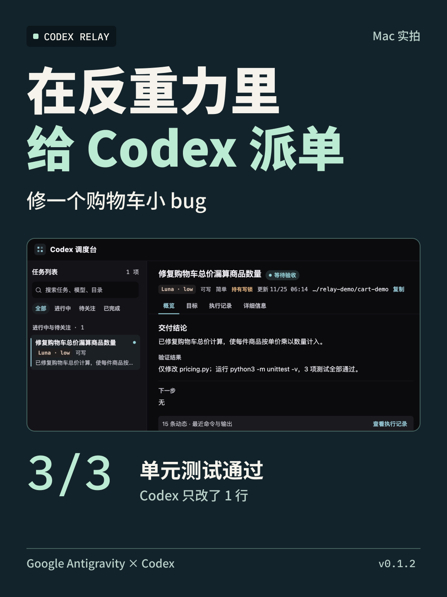
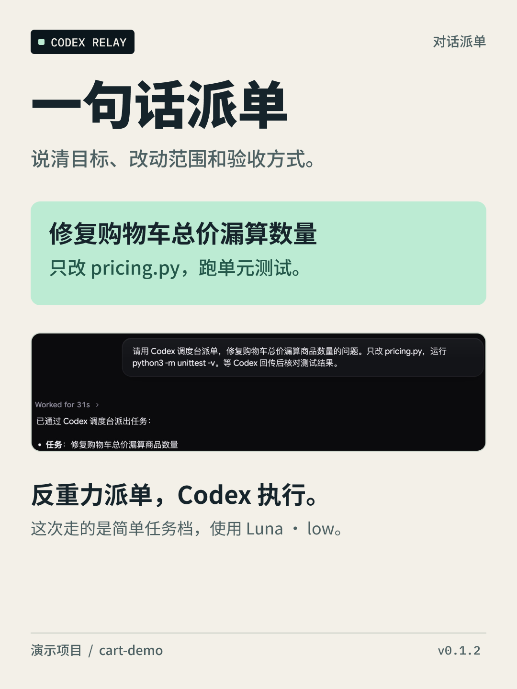
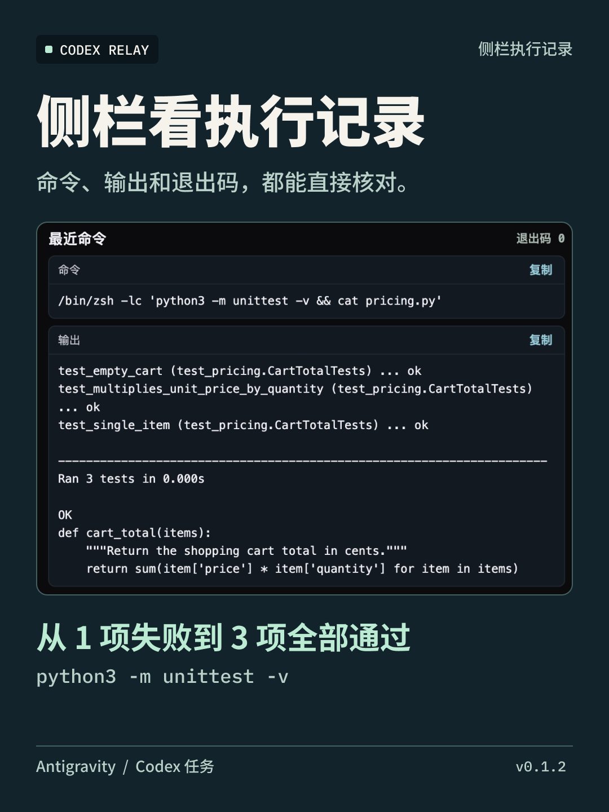
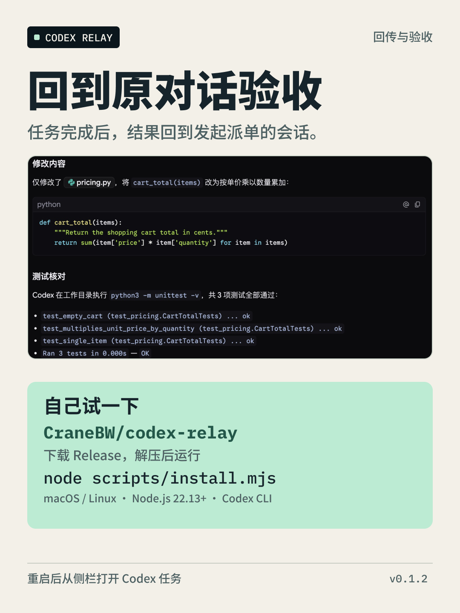

# Codex 调度台

日常工作只和反重力交互。直接在 Antigravity 对话里描述目标、补充信息、询问进度或叫停任务。反重力自行选择执行模型、邀请 Astra 讨论、处理阻塞，并在原对话给出验收结果。Codex 在当前工作目录执行。Codex 交付或遇阻时，插件向原对话发送事件。平时可以继续聊天、切换项目或关闭任务面板。

## Mac 实拍演示

在 Antigravity 对话里把「购物车总价漏算商品数量」交给 Codex。它只改了 `pricing.py` 的一行，让总价按单价乘以数量累加。修复前有 1 项测试失败，修改后 3 项全部通过。侧栏可以查看实际命令、输出和退出码，执行结束后结果回到原对话验收。

<p>
  
  
</p>
<p>
  
  
</p>

## 安装

适用 Linux 和 macOS。需要 Antigravity 桌面应用、已登录的 Codex CLI，以及 Node.js 22.13 或更高版本。在 macOS 上，插件也会从 `/opt/homebrew/bin` 和 `/usr/local/bin` 查找 Node.js 和 Codex CLI。发布包包含编译好的 MCP 服务与面板。解压后进入 `codex-relay` 目录，运行

```sh
node scripts/install.mjs
```

安装器将插件复制到 `~/.gemini/config/plugins/codex-relay/`，并启用 `codex-relay/events` 后台组件。更新已有 `config.json` 前会在同目录保存备份。升级会清理新版已移除且内容未变的文件，发现本地修改时会停止并提示具体路径。如果构建产物早于源码，先运行 `npm run build`。明确需要使用旧产物时，可加 `--allow-stale-dist`。

打开反重力项目，直接说“修复登录测试，跑通后告诉我”。在侧面板的 **＋ → 插件 → Codex 任务** 打开面板，也可以在对话中说“打开 Codex 任务面板”。如果安装前应用已经打开且尚未发现新组件，重新打开桌面应用。Google 的桌面应用负责启动和停止该后台组件。[插件开发文档](https://antigravity.google/docs/build-plugins/) · [后台组件文档](https://antigravity.google/docs/sidecars)

## 任务如何流转

- 反重力按任务选择默认模型和思考等级。简单修改用 `simple`（`gpt-6-luna` / `low`），实际点击、填表或截图验收等浏览器操作用 `browser`（`gpt-6.1-terra` / `medium`），纯前端代码修改按开发难度选档。常规开发和调试用 `standard`（`gpt-6.2-sol` / `high`），也是省略 `difficulty` 时的默认值。困难任务用 `hard`（Sol / `xhigh`），极高难度或错误代价高用 `exceptional`（Sol / `max`）。
- `relay_dispatch` 支持独立指定 `model` 和 `effort`，省略的参数按难度取默认值。例如只指定 `effort: low` 时，默认仍用 Sol。编码任务 `resume` 时也可以独立指定两项。给出 `difficulty` 时，省略的参数按新难度取默认值。省略 `difficulty` 时，省略的参数沿用上一轮。需要更强能力时，派单或续跑可显式指定 `model: 'gpt-6.2-astra'`，并配合 `effort: 'max'`。Terra 可用 `ultra`，Luna、Sol 和 Astra 最高 `max`。
- 同目录只读任务可以并发，包括 Astra Max 讨论。工作目录互不包含的写任务也可并发。同一目录或上下级目录的写任务排队，面板展示排队原因及占锁任务，当前任务验收或取消后释放写锁。任务使用当前项目目录。
- 后台组件默认同时运行最多 4 个 Codex 进程。通过环境变量 `CODEX_RELAY_MAX_CONCURRENT` 设置正整数上限。可运行的任务超出上限时，`waitInfo.kind` 为 `concurrency`，`blockers` 列出占用槽位的任务。进程退出后自动调度排队任务。
- `relay_dispatch` 和 `relay_discuss` 可以用同一对话内的 `graphId` 组成任务依赖图。`graphTitle` 设置任务群标题，`nodeLabel` 设置节点短名。先派独立节点，再以任务 UUID 或 `requestKey` 填写下游的 `dependsOn`。上游进入 `review` 后由反重力逐项验收，全部 `accept` 后下游自动参与调度。首次启动时会收到已验收上游的结论、证据与验收备注，讨论上游还会传递分歧与限制和已有的子代理交接纪要。单条结论、证据和验收备注分别最多传递 1200、1600 和 1000 字符，上游上下文合计最多 12000 字符。
- `relay_control(action: 'cancel')` 默认只取消指定任务。传 `cascade: true` 会一并取消同一对话内仍处于 `queued` 的直接和间接下游，并记录取消原因。已结束的任务也可作为级联起点。
- 反重力可以主动邀请 **Astra Max** 讨论实验、结果和方案。你也可以说“请和 Astra Max 讨论这个实验的两个解释”。每次发起前，反重力先自查问题是否框得太窄、约束或标准是否过严，在 `position` 写下判断、证据和希望被挑战的前提。`relay_discuss` 讨论和追问固定使用 `gpt-6.2-astra` / `max` 与 `default`（`read-only` + `on-request`）。收口时，反重力亲自重审预设与替代路径，再作出定论。发言和最终结论保存在 SQLite，面板可加载更早的发言。
- 面板的任务列表、依赖图和详情头部都显示当前模型、思考等级和会话权限，续跑调整后随状态刷新。完全开放、免审批和严格审批均有文字标识。详情可查看目标、目录和当前步骤。「执行记录」可查看最近 5 条命令的状态、退出码和输出片段。详情字段 `commands` 按执行顺序返回，`command` 仍指向最新命令。
- 有任务群时，面板按依赖层级绘制节点和箭头，可切换任务群并点击任意节点查看详情。图外占锁任务通过写锁等待连线接入。任务头部的群徽章可打开对应依赖图，详情中的前置任务和后续任务可直接跳转。
- 一次命令失败会记入进度。当 Codex 明确报告无法推进、请求宿主介入，或执行轮次异常结束时，插件唤醒反重力。它可以给 Codex 一条新线索，也可以先接手工作目录解决问题，再把结论交还原会话。
- 轮次默认连续 30 分钟未收到 RPC 活动时触发中断，转为 `blocked`，释放写锁和并发槽位并唤醒主对话。环境变量 `CODEX_RELAY_TURN_IDLE_MS` 以毫秒设置该时限，`0` 关闭检测。Codex RPC 消息和主对话追加指令会重置计时。
- Codex 报告交付后，反重力收到事件并核对文件和验证结果。只有新线索耗尽、需要用户决策或需要用户提供信息时，反重力才在原对话里提问。
- 完全退出应用时保存进度并停止执行。重开后沿用原 Codex 会话，核对退出前已完成的步骤，再安排余下工作。运行到一半的系统进程需要检查现场后续跑。

## 面板筛选

`relay_board` 打开面板。`relay_board_changes` 的 `filter` 支持 `all`（默认）、`active`（执行中或排队）、`attention`（待验收或待处理）和 `done`。`query` 忽略大小写，多个空白分隔的关键词须同时命中任务标识、标题、节点、任务群、模型与等级、目录、权限或状态。`workspace` 匹配该目录及其子目录。面板在有多个任务工作目录时显示工作区下拉框。

`filteredTotal` 返回分页前的匹配数，`total` 始终返回全量任务数，`workspaces` 返回去重排序的工作目录。`includeGraphs` 默认 `true`，完整依赖图独立于列表筛选和分页。图折叠时面板传 `includeGraphs: false`，此时 `graphs` 为空数组，`hasGraphs` 仍表示是否有任务群。

## 委托子代理与 Astra Max 多轮讨论（方案 B）

1. 主对话先自查思维定式和可能过严的约束，把希望被挑战的前提与发散方向写进议题和 `position`。用 `relay_discuss(delegate: 'subagent', ...)` 创建节点，填 `graphId` 和所需的 `dependsOn`，再把任务 ID 与收敛条件交给一个 `self` 子代理（`Model: 'inherit'`）。子代理严禁再派生子代理。任务登记后就出现在图中，首轮等待直系子代理 `claim`。若子代理已就绪且已知其对话 ID，可只传 `delegateOrigin` 直接绑定。重试沿用首次委托参数，变更委托参数需要新的 `requestKey`。
2. 子代理与 Astra Max 一起检验前提是否过严，探索替代路径。认领启动或 `resume` 后用 `schedule(..., TimerCondition: 'any')` 挂起等待通知。通知发给当前持有讨论控制权的对话。子代理只能读取当前绑定给自己的主对话任务，严禁 `accept` 或 `cancel`。
3. 收敛后，子代理用 `handover` 保存交接纪要，标出共识、证据、分歧、可能过严的前提和新视角。省略 `schedule`，结束本轮并向主对话汇报。主对话可以随时收回未结束的讨论。子代理连续两次通知失败也会触发回退，通知切回原主对话。
4. 主对话核对讨论与交接纪要，跳出双方争论，重新审视自己的目标、标准和限制。必要时推翻原假设、放宽非本质约束或综合新方案，再用 `accept` 写最终定论并放行下游。仅在需要 Astra 补充影响定论的关键原始证据时用 `resume`。面板分别显示主对话、子代理和 Astra Max 的发言，以及交接纪要和最终定论。

`relay_inspect` 指定 `id` 或 `relay_board_changes` 指定 `selected` 时，详情默认返回最近 8 条发言。`discussionLimit` 可设置为 1–100，`discussionOffset` 从最新发言向前跳过指定条数，每页按时间正序展示。例如，`discussionLimit: 8`、`discussionOffset: 8` 读取倒数第二页。`discussionTotal` 是总条数，`discussionTruncated` 表示该页之前仍有更早发言。

## 会话权限

反重力可在 `relay_dispatch` 派发编码任务，或在 `relay_control` 的 `resume` 续跑时，显式选择 `permission`。

| 预设 | 沙盒模式 | 审批策略 | 使用时机 |
| --- | --- | --- | --- |
| `default` | `read` 用 `read-only`，`write` 用 `workspace-write` | `on-request` 按需审批 | 日常任务，首次派单省略权限时使用 |
| `auto` | 同 `default` | `never` 免审批 | 用户已授权免审批，且操作可在所选沙盒内完成 |
| `full`（完全开放权限） | `danger-full-access` | `never` 免审批 | 用户明确要求完全开放，或任务确需跨工作区、联网等操作且用户已授权解除沙盒与免审批 |

可独立覆盖 `sandbox` 或 `approvalPolicy`。`read-only` 只读，`workspace-write` 允许在工作区写入并沿用 Codex 的联网配置，`danger-full-access` 移除 Codex 沙盒限制。`on-request` 允许按需申请审批，`untrusted` 对非可信命令请求审批，`never` 禁止发起审批并遵循所选沙盒。`mode: read` 只允许 `read-only`，禁止 `full`。目录写锁按任务的 `mode` 和工作目录调度。Astra Max 讨论及追问固定为 `default`（`read-only` + `on-request`）。

续跑时传入 `permission`，省略的沙盒或审批项按新预设选择。省略 `permission` 时，逐项沿用上一轮。`requestKey` 重试按首次派单的权限组合核对，变更首次权限时需要新的 `requestKey`。发生 `requestApproval` 且操作超出现有授权时，反重力先用 `ask_user` 标记等待并在原对话征求确认，禁止静默切换到 `full`。

面板「详细信息」显示完整的沙盒模式和审批策略、累计执行耗时和 Codex 轮次数。`relay_inspect` 和 `relay_board_changes` 返回 `permission`、`sandbox` 和 `approvalPolicy`。`permission: custom` 表示实际组合不同于该任务模式的三个预设。耗时从连接 Codex 到执行结束，排队和待验收时间不计入。异常退出时计至最后一次持久化记录，旧任务的历史数据从启用计量后开始累计。

## 本地数据与事件

SQLite 的 `tasks.sqlite` 位于 Antigravity 分配给该后台组件的持久化数据目录，通常为 `~/.gemini/antigravity/sidecar_data/codex-relay/events/data/`。数据库存放任务、原对话 ID、Codex 会话 ID、队列、当前状态、近期活动和待投递事件。项目文件保存在派单工作目录。Codex 本身管理其会话历史。[Google 后台组件数据目录](https://antigravity.google/docs/sidecars) · [Codex App Server](https://developers.openai.com/codex/app-server)

任务转入“等待反重力”或“等待验收”时，状态和通知一起提交到 SQLite。后台组件通过 `agentapi send-message` 串行投递同一对话的通知，最多并行投递 4 个不同对话。失败后退避重试，主对话默认最多尝试 12 次，可通过环境变量 `CODEX_RELAY_NOTICE_MAX_ATTEMPTS` 设置。达到上限后任务的 `delivery` 为 `failed`，详情保留错误及活动记录。已失效的通知记录会被清理。极端情况下，宿主已收件但插件尚未来得及记录回执，重开会重送同一个事件 ID。接收方按事件 ID 和任务当前状态核对。外部命令的副作用由续跑时的现场检查确认。

面板使用 Antigravity 的 MCP Apps 侧栏接口。工作区和原对话由宿主钩子注入，后台组件通过仅本机当前用户可访问的 Unix 套接字与 MCP 服务通信。[MCP Apps 面板](https://antigravity.google/docs/mcp-apps/) · [宿主钩子](https://antigravity.google/docs/hooks)

## 从源码构建

```sh
npm ci
npm run build
```

MCP 服务与面板在 `dist/`。后台组件和 Codex 协议处理在 `sidecars/events/` 与 `src/`。反重力处理阻塞、验收和向用户提问的规则在 `rules/AGENTS.md`。

输入 `/codex-playbook` 查看随插件安装的中文提示词，涵盖编码派单、并行拆解与依赖图、阻塞交接、实验设计、结果复核、方案比较和同一会话追问。[提示词全文](skills/codex-playbook/SKILL.md)

运行 `npm run doctor` 检查 Node.js、Codex CLI、agentapi、构建时效、后台套接字和锁，以及 SQLite 可读性和各表行数。后台尚未启动或数据库尚未创建时会显示警告。

运行 `npm test` 执行单元测试和全部模拟回归，覆盖面板、安装升级、派单续跑、依赖图、通知及恢复。只运行单元测试可用 `npm run test:unit`。测试使用临时目录与可控的 Codex 进程。运行 `python3 -B tests/probe.py` 或 `python3 -B tests/discussion.py` 会分别调用真实编码模型或 Astra Max，使用本机 Codex 账户，并把测试通知送到临时接收器。
